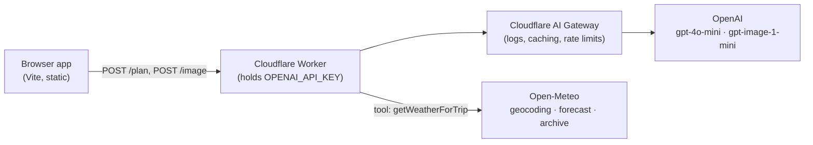

# AI Travel Agent

An AI agent that plans a trip — weather, flight, hotel and activities — from a short form, using OpenAI tool calling and live weather data.

**Live demo:** https://travel-agent-app.mkarlen96.workers.dev


## Architecture



The frontend never sees an API key: all model calls go through the Worker, which routes OpenAI traffic through Cloudflare AI Gateway.

## How it works

1. The user enters travellers, origin, destination, dates and budget. The Worker validates the input (`POST /plan`).
2. **Agent loop with tool calling.** `gpt-4o-mini` is given one tool, `getWeatherForTrip(city, startDate, endDate)`. When the model returns `finish_reason: "tool_calls"`, the Worker runs the tool, appends the result as a `role: "tool"` message and calls the model again (max 5 iterations).
3. **Real weather data.** The tool geocodes the city with Open-Meteo and returns low/high °C, rainy days and the dominant condition. Open-Meteo forecasts only ~16 days ahead, so for later dates it uses the actual weather on the same dates a year earlier and tells the model so.
4. **`tool_choice` guard.** Once tool results are in, the next request sets `tool_choice: "none"`, so a small model cannot keep calling the tool in a loop and must produce the final answer.
5. **Structured output.** `response_format: json_schema` (strict) forces `{ weather, flights, hotel, hotelName, activities[] }`, so the frontend renders fields directly instead of parsing free text.
6. The "Your Trip" screen links out to Google Flights and Booking.com searches. Flight and hotel are model suggestions, not live prices.
7. **Extras:** an optional AI postcard of the destination (`POST /image`, `gpt-image-1-mini`, low quality, only on button click) and a "Share trip" link that encodes the whole trip in the URL hash (`#trip=…`) — nothing is stored server-side.

## Stack

- **Frontend:** vanilla JS + Vite, deployed as Cloudflare Workers static assets (`@cloudflare/vite-plugin`)
- **Backend:** Cloudflare Worker, `openai` SDK
- **AI:** OpenAI `gpt-4o-mini` (tool calling, JSON schema output), `gpt-image-1-mini`, via Cloudflare AI Gateway
- **Data:** Open-Meteo (no API key)

## Project structure

```
worker/   Cloudflare Worker: POST /plan (agent), POST /image      :8791
  src/index.js   agent loop, json_schema, tool_choice guard, input validation
  src/tools.js   getWeatherForTrip tool + its JSON schema
app/      Vite frontend (form → "Your Trip" screen)                :5174
```

## Run locally

Requires Node 20+ and a Cloudflare account (for `wrangler`).

```bash
# 1. Worker
cd worker
npm install
cp .dev.vars.example .dev.vars        # put your OPENAI_API_KEY here
npx wrangler dev                      # http://localhost:8791

# 2. Frontend (second terminal)
cd app
npm install
cp .env.example .env.development.local   # points the app at the local worker
npm run dev                              # http://localhost:5174
```

> The Worker calls OpenAI through an AI Gateway URL hardcoded in `worker/src/index.js` (`gateway.ai.cloudflare.com/v1/<account-id>/<gateway>/openai`). Replace the account ID and gateway name with your own, or remove `baseURL` to call OpenAI directly.

## Deploy

```bash
cd worker
npx wrangler secret put OPENAI_API_KEY   # or: npx wrangler secret bulk .dev.vars
npm run deploy

cd ../app
# point the production build at your worker:
echo "VITE_TRAVEL_WORKER_URL=https://<your-worker>.workers.dev" > .env.production.local
npm run deploy                           # vite build + wrangler deploy
```

## Notes

- Weather is in °C. Trips more than ~16 days out use last year's actual weather for the same dates.
- Flights and hotels are recommendations from the model; there is no booking or live pricing API.

---

Built as part of the **AI Engineering Specialization (Coursera × Scrimba)** — solo project of the *Learn AI Agents* course.

License: [MIT](LICENSE)
